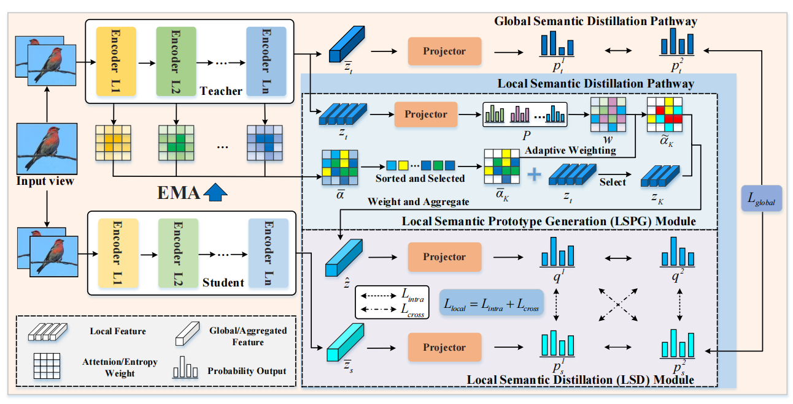

# Dual-Path Discriminative Semantic Distillation for Self-Supervised Fine-Grained Visual Recognition

This is the  implementation of  paper: Dual-Path Discriminative Semantic Distillation for Self-Supervised Fine-Grained Visual Recognition

By Ting Yang, Lei Huang, Jie Nie and Zhiqiang Wei. 
> **Abstract:** 
Self-supervised learning has achieved remarkable performance in generic representation learning. However, most existing approaches often struggle in fine-grained visual recognition, as they tend to focus on globally dominant patterns while neglecting subtle but discriminative patterns that are essential for distinguishing visually similar categories. 
> To address this limitation, this paper proposes Dual-Path Discriminative Semantic Distillation (DP-DSD), a novel fine-grained self-supervised framework that prioritizes a local distillation pathway to explicitly discover and transfer category-specific knowledge, while a global pathway preserves holistic semantic consistency, jointly producing representations with enhanced fine-grained separability and global coherence. Specifically, the local pathway is structured around two synergistic modules. 
> A Local Semantic Prototype Generation module is designed to characterize discriminative information via two complementary signals, with attention indicating saliency and entropy reflecting distinctiveness, which together consolidate stable semantic prototypes. Building upon these prototypes, we propose a Local Semantic Distillation module to transfer discriminative signals through intra- and cross-view. 
> In parallel, the global pathway aligns global distributions to preserve holistic semantic coherence. Extensive experiments on three widely used fine-grained benchmarks demonstrate the effectiveness of the proposed framework and its superiority over several state-of-the-art methods across different evaluation settings.


## Datasets
Experiments on **three image datasets**:
FGVC-Aircraft，Stanford Cars, CUB-200-2011

|#|Datasets|Download|
|---|----|-----|
|1|FGVC-Aircraft|[Link](https://www.kaggle.com/datasets/seryouxblaster764/fgvc-aircraft)|
|2|Stanford Cars|[Link](https://www.kaggle.com/datasets/eduardo4jesus/stanford-cars-dataset)
|3|CUB-200-2011|[Link](https://www.kaggle.com/datasets/wenewone/cub2002011)  |


## Pretrained Model
You can download  pre-trained  models: [Swin-T, Pretrain on ImageNet-1k](https://github.com/SwinTransformer/storage/releases/download/v1.0.0/swin_tiny_patch4_window7_224.pth)

 ## Environment
```python
pip install -r requirement.txt
```

## Training/Resume Training

```python
CUDA_VISIBLE_DEVICES=0,1 torchrun --nproc_per_node=2 --master_port=29601 main_DP-DSD.py --cfg experiments/imagenet/swin/swin_tiny_patch4_window7_224.yaml
```

## Test/Evaluation

```python
CUDA_VISIBLE_DEVICES=0 torchrun --nproc_per_node=1 --master_port=29601 eval_linear.py --arch swin_tiny --cfg experiments/imagenet/swin/swin_tiny_patch4_window7_224.yaml MODEL.NUM_CLASSES 100
```

## License & Acknowledgment

We are very grateful for these excellent works: [EsViT](https://github.com/microsoft/esvit),[DINO]( https://github.com/facebookresearch/dino). Please follow their respective licenses for usage and redistribution. Thanks for their awesome works.

## Cite

```
@ARTICLE{xu2026,
  author={Ting Yang, Lei Huang, Jie Nie and Zhiqiang Wei},
  journal={IEEE Transactions on Circuits and Systems for Video Technology}, 
  title={Dual-Path Discriminative Semantic Distillation for Self-Supervised Fine-Grained Visual Recognition}, 
  year={2026}
}
```